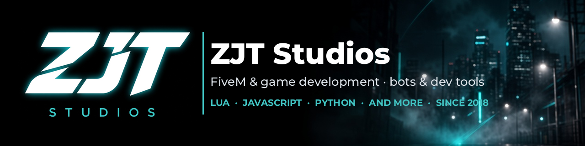
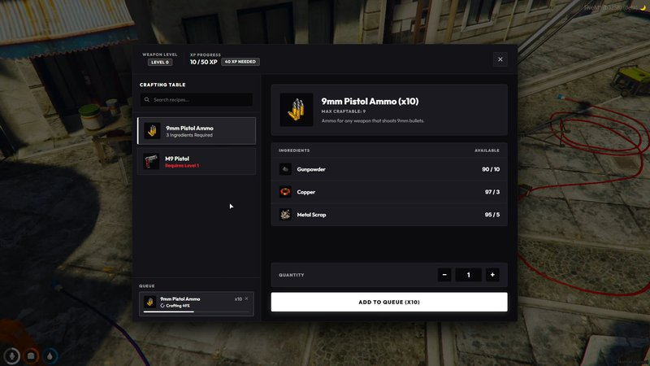

  

  
  

### Hey, this is ZJT Studios 👋

I've been building for FiveM since 2018. I make RP server systems that stay light on resmon, plus the Discord bots and dev tools that keep a server running smoothly.

**What I build**

- 🎮 **FiveM & RP systems.** Gameplay scripts for Qbox, QBCore, ESX and standalone/custom servers, with clean configs and server-side validation.
- 🛠️ **Game tooling.** In-game debug and test tools, MLO and asset work, and automated test loops.
- 🤖 **Discord bots & dev tools.** Bots that link Discord to the game server: bug reports, tickets, restarts and staff tools.

**Tech I use**

  
  
  
  
  
  
  
  
  
  

---

### 📌 Featured projects

<table>
  <tr>
    <td width="45%"></td>
    <td>
      <h4><a href="https://github.com/ZJTStudios/zjtcrafting">zjtcrafting</a></h4>
      A placeable crafting table with XP, levels and level-locked recipes. It has a draggable NUI tablet, a crafting queue that keeps running and server-side checks, all at <b>~0.00 ms resmon</b>.  
      <code>Lua</code> <code>NUI</code> <code>Qbox</code> <code>QBCore</code> <code>ESX</code> <code>Standalone</code> <code>ox_lib</code>
    </td>
  </tr>
</table>

**Coming soon**

| Project | What it is |
|---|---|
| **Discord ⇄ FiveM dev pipeline** | A closed-loop QA pipeline for FiveM. Test, report, triage, patch and restart all run autonomously around the clock, with no humans needed in the loop. Discord acts as the control plane, bridged straight into the live server. |

---

### 📫 Contact

- 💬 Discord: [ZJT Studios](https://discord.com/invite/GdD3FWTx6h)
- ▶️ YouTube: [@ZJTStudios](https://www.youtube.com/@ZJTStudios)

<!-- Optional stats card (public, no token needed). Uncomment if you want it:

  

-->
